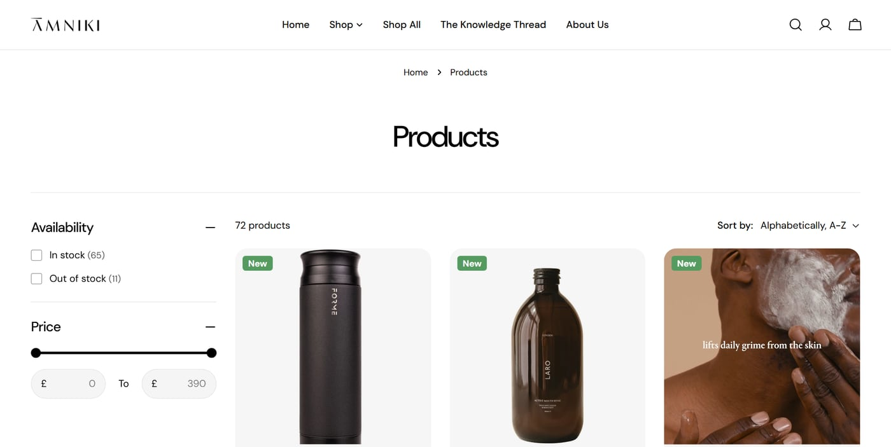

{/* Read from the live store (2026-11-02): 72 products, £9 to £390. The apps were read from the store's scripts, so the owner should confirm them and say what each is used for. The owner co-founded it (the owner, 2026-11-04). Mujtaba to review every sentence. */}

## The idea

A curated store where people can discover wellness and lifestyle brands in one place: accessories,
selfcare and wellness, with technology to come.

## What I did

I co-founded AMNIKI. Together we set up the store on Shopify, chose the brands and built up the
range, from £9 to £390, with AMNIKI Signature, a small line of its own, alongside them. We also set
it up for customers outside the UK.

<Figure caption="The full range: 72 products, with filters for availability and price">

</Figure>

## Key decisions

**Build on Shopify.** It already handles the checkout, payments and orders, which left us free to work
on the brand and the range.

**Sell beyond the UK from the start.** The store runs in three languages, with local currencies for
more than 30 countries.

**Write as well as sell.** The Knowledge Thread, the store's blog, gives people a reason to come back
between orders.

## How I used AI

I used low-code, no-code and AI tools to move quickly from an idea to a working store. There's no AI
inside the store itself.

## Where it is now

It's live at [amniki.com](https://amniki.com), so feel free to have a look around. The technology
range is on its way.
