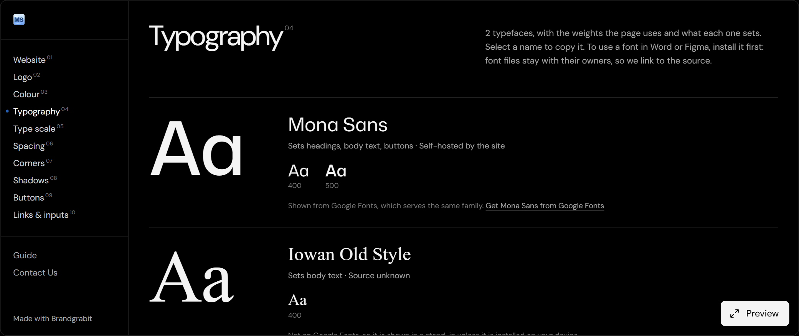

{/* From the Brandgrabit repo and its product brief (2026-11-02). No user numbers: the owner hasn't marketed it. Mujtaba to review every sentence. */}

## The idea

Before a redesign or a pitch, someone has to dig out a client's logos, exact colours, fonts and
button styles. And when you build with AI tools, the result tends to look like everything else
unless you can show them a real brand to follow. I wanted to paste a link and get all of that back,
ready to use.

I picked it from 35 ideas during a one-week build sprint I set myself. The main goal was learning:
taking something from an idea to a secure, working product.

## How it works

You paste a link. A real browser opens the page and measures what's actually there: colours, fonts
and sizes, spacing, corners, shadows, buttons, links and form fields. It also reads up to two more
pages from the site, plus its dark mode and phone layout if it has them.

You get a brand board, with colours grouped by the job they do, and five downloads: CSS variables, a
Tailwind theme, design tokens for Figma plugins, a shadcn/ui theme and a DESIGN.md file for AI coding
tools.

<Figure caption="The board's typography section, reading this site: each typeface, its weights and what it sets">

</Figure>

## Key decisions

**Measure, don't guess.** Reading the live page is slower than scanning its code, but much more
accurate. My own store's theme declares a red that never appears on the page, and reading the code
alone called that its brand colour.

**Plan for blocked sites.** Some sites block automated visits. When that happens, the board falls
back to the site's code and says it's a partial read, and a bookmark can read the page in your own
browser instead.

**No AI in the product.** Version 1 measures rather than generates, so I don't call it AI-powered. AI
was how I built it, and the downloads are made for AI tools to use.

**Cheap to run.** It runs on free plans with daily limits, so it can stay free to try while I learn.

## How I used AI

I wrote the spec and build plan first, then built it with Claude Code in small steps, reviewing each
change before it went in. Every change runs through automatic checks, and nothing merges if they
fail. I check accuracy against a fixed set of 34 real sites, so a fix for one site can't quietly
break another.

## What I learned

Speed turned out to be an accuracy problem. Heavy shop sites ran past the browser's time limit and
dropped to the weaker read, which explained most of the wrong results I was seeing.

A test set also beats spot checks. It's easy to tune a product to whichever site you looked at last.

## Where it is now

It's live at [brandgrabit.com](https://brandgrabit.com) and free to try. I haven't marketed it yet: a
handful of testers have used it, and their feedback has shaped the fixes. I built it mainly for my
own learning, and I'm still working out where it goes next.
