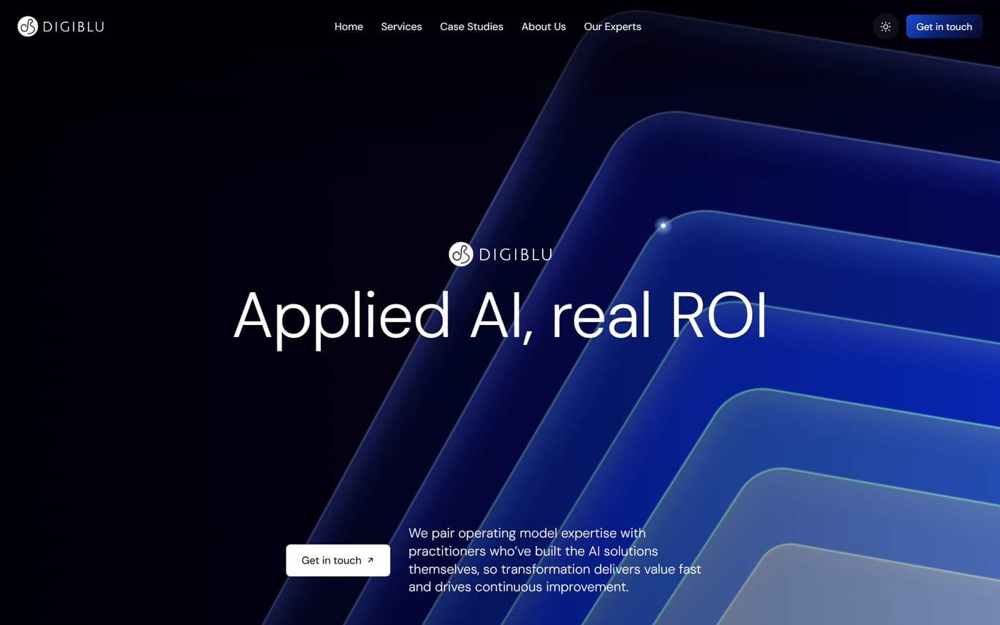
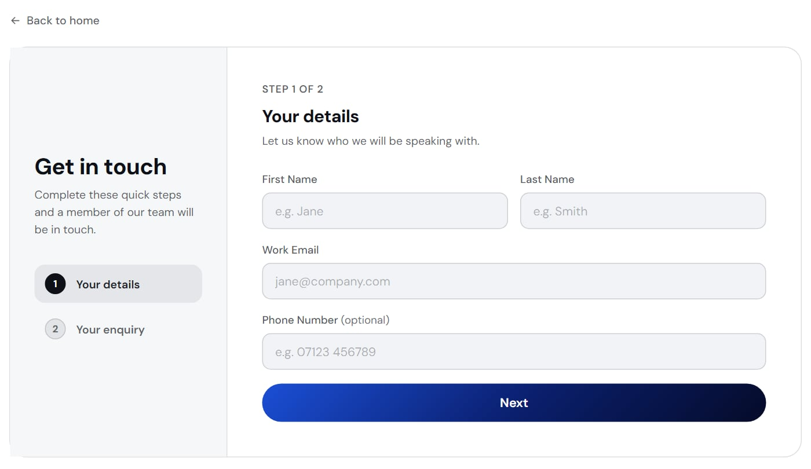

{/* From the DigiBlu website repo (README, CLAUDE.md, docs/notes) and the owner (2026-11-02): DigiBlu agrees to being named. 206 of 223 commits are the owner's, first commit 7 Aug, live 25 Sep. "The brief" is partly inferred. Mujtaba to review every sentence. */}

## The brief

DigiBlu's old website ran on Wix. The company needed a site that showed its AI and digital
transformation work properly, and one it could keep changing itself.

I took it on from the start: what the site had to say, how it should look, and then the build.

## What I did

I set the structure and the message, designed the pages, and moved the content across: six services,
nine case studies, the team and the accreditations.

My first version was a single hand-built site, which was quick to change while the design settled.
Once it had to run as a real company website, I rebuilt it on Next.js and carried the design across.

<Figure caption="The home page: the headline, the artwork and one clear way to get in touch">

</Figure>

<Figure caption="The contact form: two short steps, with Cloudflare Turnstile checking for spam">

</Figure>

## Working with our technical architect

I built the site, and our technical architect made sure it was ready for enterprise use. Together we
got the hosting, security and scale right. They set up the release pipeline, the redirects from the
old site and the email sending.

Their review changed the design too. They asked for every service, case study and biography to have
its own page, in place of the pop-ups I had built, and I rebuilt them that way.

## Key decisions

**A page for everything.** Each service, case study and biography can be linked to and found in
search on its own.

**Keep the old links working.** Old Wix addresses redirect to their new pages, so links people had
already saved or shared still land somewhere useful.

**Ask before measuring.** Analytics load only after a visitor allows them, and the privacy policy
says exactly what the site stores.

**Preview first.** A change goes to a private preview, and only a tagged release reaches the live
site.

## How I used AI

I built it with Claude Code in small steps, reviewing each change, with tests over the content, the
contact form and every page. I also kept notes on each decision in the repo, so our team and the next
AI session could work from the same facts.

## What I learned

Test what visitors actually get. The quick local build behaves differently from the version running
on Cloudflare, so I learned to check the real thing before every release.

Keep notes short. Mine grew until our technical architect asked me to cut the main file down, and
they were right: it's far more useful as a summary, with the detail kept elsewhere.

## Where it is now

It has been live at [digiblu.com](https://www.digiblu.com) since 25 September 2026, and I'm still
looking after it.
