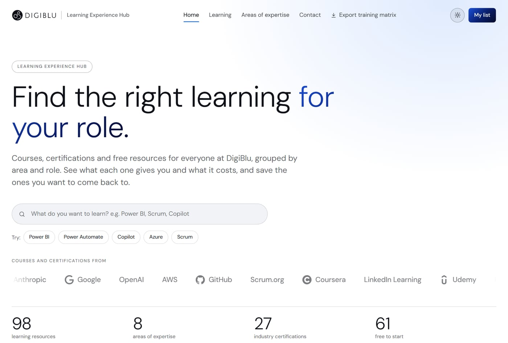
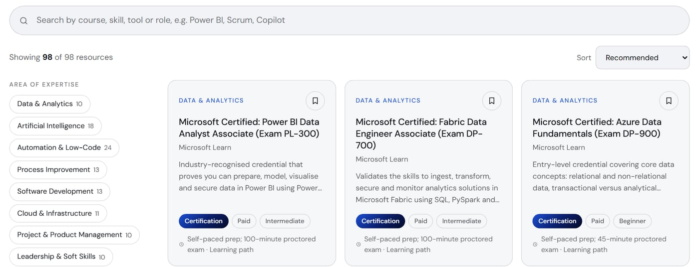

{/* From the Hub's repo and the LXP options deck (2026-11-02). DigiBlu agrees to being named. No link on purpose: the Hub is for DigiBlu's staff and is meant to go behind sign-in. No prices from the deck. Mujtaba to confirm how the options work led to this pilot, and to review every sentence. */}

## The problem

DigiBlu wanted a better way to support learning and onboarding across the company: something people
would actually open, and not one more document library.

## Starting with the options

I compared the routes for our leadership team: extending what we already have in Microsoft 365, buying
a ready-made learning platform, or building our own. I looked at what each would cost, what it would
do and how people actually learn at work, then put forward a recommendation.

## What I built

The Hub is the first version, running as a pilot. It's a guide to 98 courses, certifications and free
resources across eight areas of expertise, each showing what it gives you and what it costs.

<Figure caption="The home page: start with a search, or with what you want to learn">

</Figure>

People can search, filter by what they'd get (a certification, a completion certificate or just the
knowledge), cost, level and format, and save courses to their own list. They can also export a
training matrix as an Excel file, with a sheet per area, the courses across the top and rows for
people to grade from 0 to 5.

<Figure caption="The Learning page: search, areas of expertise, and what each course gives you">

</Figure>

## Key decisions

**Start static.** With no server or accounts to run, the pilot was quick to build and cheap to change
while we learn what people need.

**Keep names out of it.** The training matrix is made in the browser, so names typed into the file
never reach the Hub.

**Make updates hard to break.** Adding a course means editing one file. If a field is missing or
misspelled, the build stops and names the entry.

**Public information only, for now.** Until it sits behind sign-in, the Hub holds only public course
information, and every page is marked to stay out of search engines.

## How I used AI

I built it with Claude Code in small steps, reviewing each change, and followed the brand guide from
the DigiBlu website, so the two look like the same company.

## Where it is now

It's a version 1 pilot. Next, it moves to Cloudflare behind DigiBlu's sign-in, ready for a wider
rollout. It's internal, so there's no public link here.
