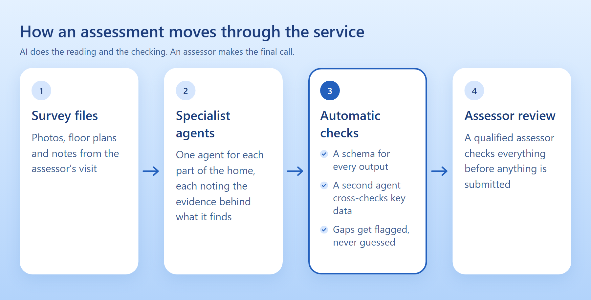

{/* From the build bundle and the owner (2026-11-02): joint venture, work in progress, the owner's part is coordination, Kanban and solution design. Anonymised on purpose: no product name until the owner says (2026-11-04), no addresses, people, customers, pricing, portal name or Claude plan details, and nothing about who founded or owns it. Mujtaba's partner should see this page before it goes live. Mujtaba to review every sentence. */}

## The problem

After visiting a home, a retrofit assessor has to turn their photos, floor plans and notes into a
detailed energy assessment, then key it all into specialist software by hand. It's slow, repetitive
and easy to get wrong.

## The idea

Let AI do the reading and the preparation, and keep the assessor in charge of the result.

<Figure caption="The flow: specialist agents read the files, automatic checks test what they find, and an assessor reviews it all">

</Figure>

## My part

I'm part of the small team behind it, and my focus is the project side rather than the code. I
coordinate the work on a Kanban board, and I work on the solution design: how the pieces fit together,
where people stay in the loop, and what has to be true before a step can move on.

## Key decisions

**Never invent.** If the evidence isn't there, an agent has to flag the gap. It doesn't get to fill it
with a good guess.

**A person signs off.** Nothing gets submitted until a qualified assessor has reviewed it.

**Checks between every step.** Each agent's output is tested before the next step can use it, and key
data gets a second, independent look.

**Data protection from the start.** It handles information about people's homes, so that went into the
design early on.

## Where it is now

It's still a work in progress. It has run end to end on real assessments, and we're refining it before
it can go out as a service. I've left customers, pricing and other details off this page on purpose.
